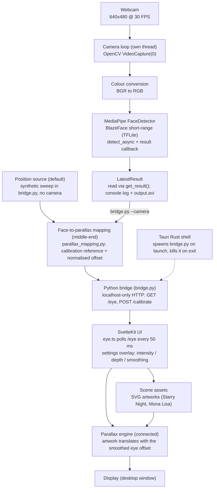

# Pralax - Prototype Workflow (Phase 1 submission, "Workflow + Code")

Project 2.1, Group 3 - Pralax, an Eye-Tracked Parallax Viewer

This document describes how the program works end to end - data input -> processing -> intelligent algorithm -> output/interaction - and how the components connect, at the state of the project one week after Phase 1.

## 1. What exists after Phase 1

The frontend and the backend are connected end to end:

1. **Eye-tracking module** (`FaceTracking/Face.py`) - running, standalone. Python + MediaPipe. A threaded camera loop detects the face in every webcam frame with the BlazeFace short-range model and stores the latest detection (bounding box + 6 facial keypoints, including both eyes) so other components can read it through the controller API `get_result()`. Needs a webcam.
2. **Face-to-parallax mapping** (`FaceTracking/parallax_mapping.py`, Sotiris) - the middle-end. Implements the reference-point calibration, EMA smoothing and per-layer displacement (`offset = intensity * eye * k / depth`).
3. **Bridge** (`FaceTracking/bridge.py`) - written and connected. A stdlib-only HTTP server on 127.0.0.1:8765 that publishes the normalised eye offset as JSON (`GET /eye`, `POST /calibrate`). By default the position comes from a synthetic sweep, so no camera is needed; `python bridge.py --camera` uses the webcam tracker and falls back to the sweep while no face is detected.
4. **Application shell + UI** (`GUI/`) - connected. The Tauri Rust shell spawns the bridge on launch and kills it on exit. The SvelteKit UI polls `/eye` every 50 ms (`eye.ts`), applies EMA smoothing with the smoothing slider, scales the offset with the intensity and depth sliders, and translates the artwork. The settings overlay shows the live eye position and the bridge connection status.

Remaining Phase 2 work: bundling the bridge as a packaged Tauri sidecar, the calibration wizard, and the layered 2.5D / Three.js engines (T2.1 packaging, T2.2, T2.6). Also produced in Phase 1 but not in this repository: the Blender test scene (Justin, Rotem); it is integrated in Phase 2 (T2.3, T2.7). The Phase 1 demo video is submitted separately.

## 2. Workflow diagram

Solid arrows: data flow, connected and running. Dotted arrow: process lifecycle only (the Rust shell spawns and kills the bridge; no data flows through it).

## 3. Step by step: input -> processing -> algorithm -> output

### 3.1 Data input
- **Position source (default).** A slow synthetic sweep generated inside `bridge.py` - no camera needed, so the whole chain runs on any machine.
- **Camera frames (with `--camera`).** OpenCV reads the default webcam at 640x480 @ 30 FPS in a dedicated thread (`thread_function` in `FaceTracking/Face.py`); while no face is detected the bridge falls back to the synthetic sweep.
- **User input.** In the GUI: scene switching (arrow keys or overlay buttons) and three settings - intensity (0-1), depth (0-100 px), smoothing (0-1) - bound live to Svelte state in `GUI/src/routes/+page.svelte` and `GUI/src/routes/overlay/overlay.svelte`.

### 3.2 Processing
- **Bridge.** Every request to `GET /eye` returns the mapper's normalised offset (reference-relative, clamped to [-1, 1]) as JSON: `{"x": ..., "y": ..., "t": ..., "source": "synthetic" | "camera"}`. The server binds to 127.0.0.1 only, answers CORS preflights, and `POST /calibrate` recalibrates the neutral reference. The reference is auto-calibrated on the first position.
- **Frontend.** `eye.ts` polls `/eye` every 50 ms into the `eye` store; `+page.svelte` applies EMA smoothing (alpha = the smoothing slider), computes the pixel offset `px = x * intensity * depth * 10`, and translates the scene wrapper. The overlay shows the live eye position, its source and a green/red connection dot.
- **Tracker path.** Each BGR frame is converted to RGB and handed to the detector with `detect_async(image, timestamp_ms)` in `LIVE_STREAM` mode, so detection runs asynchronously. The result callback `print_result()` stores the newest `FaceDetectorResult` in `LatestResult`; the bridge reads it via `get_result()` and extracts the eye midpoint with `eye_midpoint()`. A flipped copy of every frame is written to `output.avi` (XVID) as a sanity-check recording.

### 3.3 Intelligent algorithm
- **Face-detection model.** `blaze_face_short_range.tflite` - Google's pre-trained BlazeFace short-range detector, running fully on-device (CPU). For each frame it returns a bounding box and 6 keypoints: left/right eye, nose tip, mouth centre, left/right ear. Measured in Phase 1 (see `main.pdf`, Section 3.2): about 29.1 FPS camera loop and about 2.3 ms average detection latency on the team's laptops, robust with and without glasses. This is why MediaPipe was selected over the tested OpenCV/C++ Haar-cascade demo.
- **Eye-position mapping (the middle-end, connected).** `parallax_mapping.py` averages the two eye keypoints into a position, subtracts the calibration reference point and normalises the deviation to [-1, 1]. The GUI smooths the stream with an exponential moving average (EMA): `p_smoothed = alpha * p_new + (1 - alpha) * p_old`, where the smoothing slider maps directly to alpha.
- **Parallax mapping.** The normalised position drives the effect: the frontend translates the artwork by `offset = intensity * position * depth * k`, so near content moves more than far content (fully layered displacement and the Three.js camera offset are Phase 2 work, T2.2). Looking at a different part of the screen therefore changes the view, as if looking through a window.

### 3.4 Output / interaction
- **Today.** The GUI artwork moves with the live eye offset (or the synthetic sweep); the overlay shows `eye (x, y) - source` with a green dot while connected and "bridge offline" with a red dot otherwise; the intensity/depth/smoothing sliders visibly change the motion. Standalone outputs: the tracker prints each detection to the console and records `output.avi` (webcam); `parallax_mapping.py` prints the smoothed offset and per-layer displacements for a synthetic sweep (no camera, no window).
- **Target (Phase 2).** Bundle the bridge as a packaged Tauri sidecar, add the calibration wizard, and replace the single-layer translate with layered 2.5D displacement and the Three.js camera offset.

## 4. How the components connect

| # | Component | Technology | Status after Phase 1 | Connects to the next stage via |
|---|-----------|------------|----------------------|-------------------------------|
| 1 | Webcam | hardware | used when the bridge runs with `--camera` | OpenCV `VideoCapture(0)` |
| 2 | Eye-tracking module | Python 3, MediaPipe 1.0.1, OpenCV | working standalone; wired into the bridge via `--camera` | `get_result()` -> `eye_midpoint()` -> `ParallaxMapper` |
| 3 | Middle-end: mapping, calibration, smoothing | Python (`parallax_mapping.py`) | connected - consumed by `bridge.py` | normalised offset -> bridge JSON |
| 4 | Bridge | Python (`bridge.py`), stdlib only | written and connected - 127.0.0.1:8765, CORS enabled | `GET /eye` -> frontend store |
| 5 | Tauri shell | Rust, Tauri 2 | connected - spawns the bridge on launch, kills it on exit | process lifecycle (no data) |
| 6 | UI | SvelteKit 5 + TypeScript | connected - polls `/eye`, sliders live | smoothed offset + settings -> transform |
| 7 | Parallax engine | HTML/CSS translate (prototyped); layered 2.5D + Three.js later | connected - the artwork translates; single layer for now | Phase 2: per-layer displacement + camera offset |
| 8 | Display | desktop window | working | - |

## 5. Key code (public API)

Python - `FaceTracking/Face.py` (webcam tracker, standalone):
- `start_tracking() -> None` - builds `FaceDetectorOptions` (model path, LIVE_STREAM, result callback) and starts the tracking thread.
- `thread_function(options: FaceDetectorOptions) -> None` - camera loop: read -> RGB -> `detect_async` -> record `output.avi`.
- `print_result(result: FaceDetectorResult, output_image: mp.Image, timestamp_ms: int) -> None` - async result callback; updates `LatestResult`.
- `get_result() -> FaceDetectorResult | None` - returns the most recent detection.

Python - `FaceTracking/parallax_mapping.py` (the middle-end):
- `ParallaxMapper(intensity=0.5, depth=20.0, smoothing=0.1)` - same three parameters as the GUI overlay's `ParallaxSettings`.
- `calibrate(position: tuple) -> None` - stores the neutral reference position and resets the smoothed offset.
- `update(position: tuple) -> tuple` - EMA-smoothed offset relative to the reference point.
- `layer_offset(layer_depth: float) -> tuple` - pixel displacement for a layer at the given depth; near layers move more.
- `normalized(position: tuple) -> tuple` - reference-relative, clamped deviation (used by the bridge).
- `eye_midpoint(result) -> tuple | None` - mean of the two eye keypoints of a `FaceDetectorResult`.
- `demo() -> None` - standalone demo on synthetic positions (no camera, no window).

Python - `FaceTracking/bridge.py` (frontend <-> backend connection):
- `Bridge(use_camera: bool)` - position source: camera tracker (`--camera`) or synthetic sweep; owns the `ParallaxMapper`.
- `event() -> dict` - one JSON event: `{"x", "y", "t", "source"}`.
- `calibrate() -> None` - recalibrates the neutral reference.
- `main() -> None` - `ThreadingHTTPServer` on 127.0.0.1:8765; `GET /eye`, `POST /calibrate`, CORS headers; exits quietly if the port is already taken.

TypeScript - `GUI/src/routes/eye.ts`:
- `EyeEvent { x; y; t; source; connected }` - one bridge event plus the connection flag.
- `eye` - Svelte store holding the latest event.
- `startEyePolling(intervalMs = 50) -> () => void` - polls `BRIDGE_URL` and returns a stop function.

Svelte/TypeScript - `GUI/src/routes/`:
- `+page.svelte` - subscribes to `eye`, applies EMA + intensity + depth, translates the scene wrapper; lazy scene loading via `import.meta.glob`, arrow-key scene swapping.
- `overlay.svelte` - `ParallaxSettings { intensity; depth; smoothing }`, the three sliders, scene navigation, and the live `eye (x, y) - source` / connection-dot status.

Rust - `GUI/src-tauri/src/lib.rs`:
- `spawn_bridge() -> Option<Child>` - starts `FaceTracking/bridge.py` with the system Python; the child is killed when the app exits.
- `greet(name: &str) -> String` - placeholder Tauri command.

## 6. How to run

Full app (frontend + backend connected):
- One command: `cd GUI && pnpm install && pnpm tauri` - the Rust shell starts `bridge.py` (synthetic sweep, no camera) and kills it on exit.
- Camera mode: terminal 1: `cd FaceTracking && python bridge.py --camera`; terminal 2: `cd GUI && pnpm install && pnpm dev`, then open http://localhost:1420.

Standalone (no GUI):
- Printed sweep demo: `cd FaceTracking && python parallax_mapping.py` (stdlib only).
- Tracker alone: `cd FaceTracking && pip install -r requirements.txt && python Face.py` (webcam).

## 7. Known limitations and next steps
- The GUI translate is single-layer; per-layer 2.5D displacement and the Three.js camera offset are Phase 2 -> T2.2, T2.7.
- The bridge is spawned for development; bundling it as a packaged Tauri sidecar is Phase 2 -> T2.1.
- Calibration is automatic on start (`POST /calibrate` exists); the calibration wizard is Phase 2 -> T2.6.
- Camera mode is opt-in (`--camera`); making it the default once the sidecar is bundled is Phase 2 -> T2.6.
- `output.avi` is a debug recording, not part of the product.
