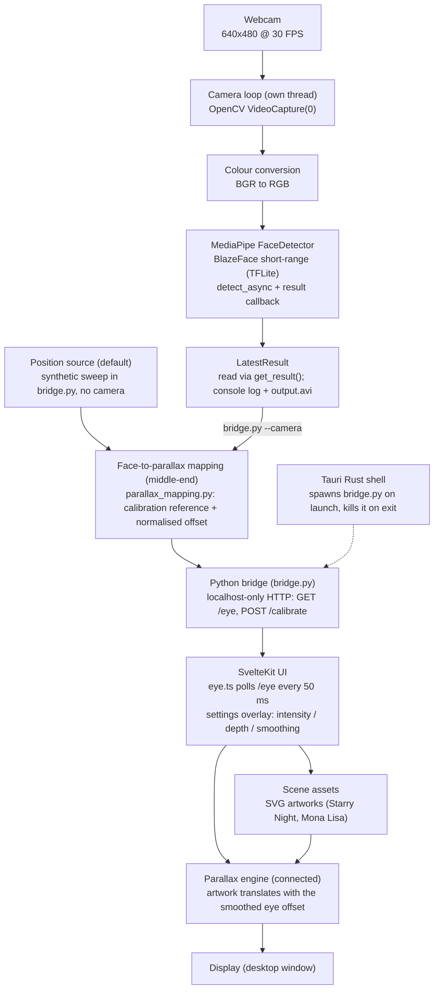

# Pralax - workflow

- input: synthetic sweep in bridge.py, or the webcam (SYN / CAM)
- processing: camera loop, BGR->RGB, BlazeFace detection (LOOP / RGB / DET / STORE)
- algorithm: calibration + EMA smoothing + parallax mapping (MAP)
- output/interaction: bridge HTTP, SvelteKit UI, artwork translate (BRIDGE / UI / ENG / DISP)

Solid arrows: data flow. Dotted arrow: process lifecycle only (the Rust shell starts and stops the bridge).

